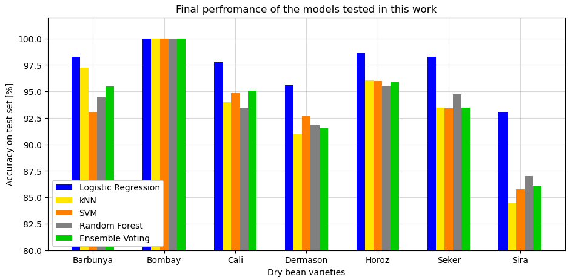

# MSc MLS – CO2 Machine Learning: Dry Bean Classification

Master course project (CO2, Machine Learning – Data Challenge 2023).

Multiclass classification of seven dry bean varieties (Seker, Barbunya, Bombay, Cali, Horoz, Sira, Dermason) from 16 shape and size features extracted from images of 13,611 grains (Koklu & Ozkan, 2020).

*Per-class results of the models tested in this work.*

## Content

The notebook covers:

1. **Data exploration:** class balance, pair plots, correlation matrix
2. **Pre-processing:** comparison of five scalers (MinMax, Standard, Robust, Quantile, Power)
3. **Classifiers with hyperparameter search** (10-fold cross-validation, held-out test set):
   - Logistic regression (one-vs-rest)
   - k-nearest neighbours (k and Minkowski exponent p)
   - Support vector machines (kernel, degree, C)
   - Tree ensembles (AdaBoost, Gradient Boosting, Random Forest)
4. **PCA:** effect of dimensionality reduction on model performance
5. **Ensemble voting classifier** and comparison of per-class test accuracy

**Main finding:** all models confused the same classes (mainly Sira vs. Dermason, and Barbunya), so the voting ensemble gained little. The colour of the beans was not among the extracted features, and adding it would probably make Barbunya easy to separate.

## Files

| File | Description |
|---|---|
| `CO2_DataChallenge_DryBeanClassification_Basil_Imoberdorf.ipynb` | Jupyter notebook with the full analysis |
| `Final_Result_BarChart.png` | Per-class results of all models (figure above) |
| `Dry_Bean_Dataset.xlsx` | Dry Bean dataset (Koklu & Ozkan, 2020), from the [UCI Machine Learning Repository](https://archive.ics.uci.edu/dataset/602/dry+bean+dataset), CC BY 4.0 |
| `BeanClasses.jpg`, `BeansClassSolo.png` | Figures from Koklu & Ozkan (2020), [doi:10.1016/j.compag.2020.105507](https://doi.org/10.1016/j.compag.2020.105507) |

## Usage

Requires `numpy`, `pandas`, `matplotlib`, `seaborn`, `scikit-learn`, `yellowbrick` and `openpyxl` (to read the Excel file). Run the notebook from this folder.

## Reference

Koklu, M., & Ozkan, I. A. (2020). Multiclass classification of dry beans using computer vision and machine learning techniques. *Computers and Electronics in Agriculture*, 174, 105507. https://doi.org/10.1016/j.compag.2020.105507
